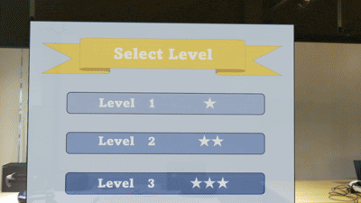
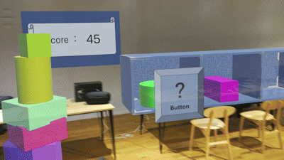

# TumikiMR - オープンキャンパス向けMR積み木ゲーム

HoloLens 2で、積み木をどこまで高く積めるかを競うMRコンテンツです。
オープンキャンパスで、中高生や保護者の方が気軽にMRを体験できることを目的に制作しました。
2023年度に学内インターンシップの活動として、個人で開発しました。

## デモ

### レベル選択と積み木の出現

### 積み木を積む様子とリザルト画面

## 制作の背景

オープンキャンパスに来る中高生や保護者の方の多くは、MRを体験したことがありません。
そこで、誰もが知っている「積み木」を題材にし、説明がなくても直感的に遊べて、MRならではの「手で直接さわる」体験ができるゲームを考えました。

## 遊び方

1. レベルを選んで、ステージを開始する(現在はレベル1のみ)
2. はてなマークのボタンを押し、ボックスに積み木を出す
3. 積み木を手でつかみ、台の上に積んでいく
4. ボックスの積み木がなくなったら、はてなマークのボタンで補充する
5. 積み木が台から落ちたらゲーム終了。積んだ高さでスコアが決まる

積み木が崩れても、台から落ちなければゲームは続きます。

## 主な機能

- **ランダム生成**:仕切りのあるボックスに、積み木が3つランダムに出現します
- **ハンドトラッキング**:積み木を直接つかむだけでなく、離れた場所からレイを合わせてつかむこともできます
- **スコア表示**:プレイ中も、現在の得点をスコアボードに表示します
- **リザルト画面**:ゲーム終了時に、スコアに応じたランクとコメントを表示します
- **不正防止**:気に入らない積み木を避けて、新しい積み木を出すような行為を防ぎます

## 使用技術

- Unity 2022.3.10f1
- HoloLens 2
- Mixed Reality Toolkit (MRTK) 2.8.3
- Mixed Reality OpenXR Plugin 1.11.1
- OpenXR Plugin 1.8.2
- C#

## 工夫した点・苦労した点

### 1. 初めてでも楽しめるゲーム性を意識した
中高生の方に楽しんでもらうことを目的としていたため、ゲーム性を意識しました。
リザルト画面でスコアに応じたランクやコメントを表示することで、初めて遊ぶゲームでも自分の実力が直感的に分かるようにしました。
また、プレイ中もスコアを表示することで、先に体験した友人と競ったり、前回の記録を超えたいという気持ちを引き出したりできるようにしました。

### 2. 不正対策をした
積み木はランダムに出現するため、気に入らない積み木を避けて、新しい積み木を出すことができないよう対策しました。

- 積み木を遠くに飛ばして、なかったことにする
  → プレイエリアを設け、積み木がそこから出たら、強制的にリザルト画面に切り替わるようにしました
- ボックスの上に積み木を置いたまま、新しい積み木を出す
  → ボックスの上に一定時間積み木が置かれ続けたら、リザルト画面に切り替わるようにしました

### 3. コンテンツ全体の大きさを調整した
台の大きさ一つで、難易度が大きく変わります。
そこで、ほかの人に実際に体験してもらい、そのフィードバックを参考にしながら、積み木と台の大きさを調整しました。

## 今後の課題

現在はレベル1のみ実装済みです。次の点は未実装で、今後の重要な改善点と考えています。

- レベル1以外のステージの制作
- 体験者に応じた台の高さ調整(身長差によって、台が低く感じたり高く感じたりするため)

## 使用アセット・クレジット

- Mixed Reality Toolkit 2.8.3(Microsoft、MITライセンス)
- 効果音:[効果音ラボ](https://soundeffect-lab.info/)
- ボタン、スコア、リザルトなどの画像は、PowerPointとCanvaで自作しました。

## 注意事項

MRTKなどのライブラリは、このリポジトリに含めていません。
また、効果音は利用規約により再配布できないため、含めていません。
そのため、Unityでプロジェクトを開くと、パッケージの読み込みエラーが出たり、音が鳴らなかったりすることがあります。
